 

Transformo caos em clareza para empresas de saúde e fintechs.

  

 

## Oi, eu sou o William

Product Designer em Florianópolis. Passei 6 anos descobrindo qual problema vale resolver antes de desenhar qualquer tela, em um sistema público usado por mais de 1 milhão de pessoas por ano e em design systems de produtos B2B. Agora eu também construo, com a IA fazendo o trabalho braçal e eu insistindo nas perguntas certas.

## Experiências

<table>
  <tr>
    <td width="50%" valign="top">
      <a href="https://williamchaves.framer.website/project/bioconex"><b>Bioconex</b></a> 
      Como redesenhamos uma plataforma B2B na Amazônia que ninguém conseguia usar.
    </td>
    <td width="50%" valign="top">
      <a href="https://williamchaves.framer.website/project/provaoeletronico"><b>Provão</b></a> 
      Levando educação para regiões remotas do Amazonas.
    </td>
  </tr>
  <tr>
    <td width="50%" valign="top">
      <a href="https://williamchaves.framer.website/project/visaohack"><b>Visão Hack</b></a> 
      48 horas ensinando UX para quem nunca tinha parado para pensar no usuário.
    </td>
    <td width="50%" valign="top">
       
      Uma nova forma colaborativa de trocar conhecimentos.
    </td>
  </tr>
</table>

## Como posso ajudar

Com discovery e research, para achar o problema real antes de qualquer solução. Com estratégia de produto, priorizando por evidência. Com UX/UI de produtos complexos, testando com usuários reais antes de desenvolver. E com design systems que o time usa de verdade, com componentes, documentação e governança.

## O que estou construindo agora

O **Distill** pega o material de uma sessão de discovery (áudio, foto de post-it, documentos) e devolve o relatório no formato que o stakeholder realmente lê. [Estado atual: em desenvolvimento] Conto o processo, inclusive os erros, no [LinkedIn](https://linkedin.com/in/williamchaves).

## Com o que eu trabalho

## Vamos conversar

Se você precisa de alguém com visão estratégica para caminhar lado a lado, o LinkedIn é o caminho mais rápido. Aviso justo: aqui tem mais protótipo do que produção. Ainda.
